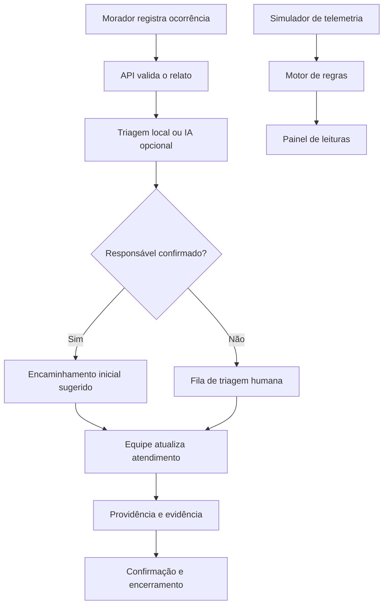

# Arquitetura — Poço Vivo MVP

## Objetivo
Demonstrar o fluxo entre relato comunitário, triagem assistida, encaminhamento ao responsável cadastrado, atendimento e confirmação humana.

## Stack
- Python 3.11+ (recomendado 3.12)
- FastAPI + Pydantic
- SQLite no protótipo local
- HTML, CSS e JavaScript responsivos
- Triagem por regras; integração opcional OpenAI
- pytest e GitHub Actions

## Limites
Este protótipo não inclui autenticação de produção, notificações reais, integração governamental ou sensores instalados. O cadastro demonstrativo não representa um responsável real. SQLite serve para demonstração local, não como recomendação final para implantação multiusuário.
